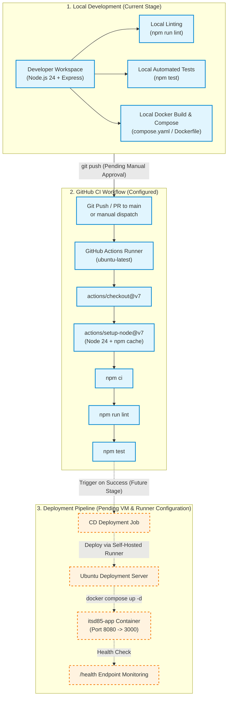

# itsd85-cicd-lab

Automated CI/CD from Local Dev to GitHub to Deployment Server — ITSD 85 Laboratory Exercise.

---

## 1. What This Project Does

`itsd85-cicd-lab` is a Node.js 24 + Express REST API designed as a testbed for implementing end-to-end continuous integration and deployment (CI/CD). It provides core endpoints for health monitoring and arithmetic computation, robust parameter validation, automated unit and integration testing via Node.js's native test runner, linting with ESLint flat configuration, container packaging via Docker and Docker Compose, and automated testing via GitHub Actions.

---

## 2. Technologies Used

- **Runtime Environment:** Node.js v24 (ES Modules, `"type": "module"`)
- **Web Framework:** Express 5
- **Testing Framework:** Node.js Built-in Test Runner (`node:test`) and Assertion Library (`node:assert/strict`)
- **Code Quality:** ESLint 10 (Flat Configuration: `eslint.config.js`) with `@eslint/js` and `globals`
- **Containerization:** Docker (`node:24-alpine`) and Docker Compose (`compose.yaml`)
- **Continuous Integration:** GitHub Actions (`.github/workflows/ci-cd.yml`)
- **Process & Architecture Modeling:** Mermaid Diagrams

---

## 3. API Endpoints

The API operates over HTTP and returns all responses in JSON format.

### 3.1. Welcome Endpoint
- **Method:** `GET`
- **Path:** `/`
- **Description:** Returns a greeting message confirming the API is reachable.
- **Sample Request:**
  ```http
  GET / HTTP/1.1
  Host: localhost:3000
  ```
- **Sample Response (HTTP 200 OK):**
  ```json
  {
    "message": "ITSD 85 CI/CD Lab API"
  }
  ```

---

### 3.2. Health Check Endpoint
- **Method:** `GET`
- **Path:** `/health`
- **Description:** Used by container orchestrators, Docker health checks, and uptime monitors.
- **Sample Request:**
  ```http
  GET /health HTTP/1.1
  Host: localhost:3000
  ```
- **Sample Response (HTTP 200 OK):**
  ```json
  {
    "status": "ok"
  }
  ```

---

### 3.3. Addition Endpoint
- **Method:** `GET`
- **Path:** `/api/add`
- **Query Parameters:**
  - `a` (required, string representing a finite number): The first operand.
  - `b` (required, string representing a finite number): The second operand.

#### Successful Calculation
- **Sample Request:**
  ```http
  GET /api/add?a=2&b=3 HTTP/1.1
  Host: localhost:3000
  ```
- **Sample Response (HTTP 200 OK):**
  ```json
  {
    "result": 5
  }
  ```

#### Negative and Floating-Point Calculation
- **Sample Request:**
  ```http
  GET /api/add?a=-5&b=15 HTTP/1.1
  Host: localhost:3000
  ```
- **Sample Response (HTTP 200 OK):**
  ```json
  {
    "result": 10
  }
  ```

#### Invalid or Missing Parameters
- **Sample Request (Missing Parameter):**
  ```http
  GET /api/add?a=10 HTTP/1.1
  Host: localhost:3000
  ```
- **Sample Response (HTTP 400 Bad Request):**
  ```json
  {
    "error": "Invalid or missing numeric parameters \"a\" and \"b\"."
  }
  ```

- **Sample Request (Non-Numeric Parameter):**
  ```http
  GET /api/add?a=hello&b=5 HTTP/1.1
  Host: localhost:3000
  ```
- **Sample Response (HTTP 400 Bad Request):**
  ```json
  {
    "error": "Invalid or missing numeric parameters \"a\" and \"b\"."
  }
  ```

---

## 4. Prerequisites

- **Node.js:** v24.x or higher
- **npm:** v11.x or higher
- **Docker & Docker Compose:** Optional for local development; required for container builds and deployment.
- **Git:** Required for version control and pushing to GitHub.

---

## 5. Local Installation and Running Instructions

1. Clone or navigate to the repository directory:
   ```bash
   cd itsd85-cicd-lab
   ```

2. Install dependencies cleanly using `package-lock.json`:
   ```bash
   npm ci
   ```

3. Start the application in production mode:
   ```bash
   npm start
   ```
   The server will start on port `3000` (or `process.env.PORT` if set).

4. Alternatively, start in development watch mode (auto-reload on code change):
   ```bash
   npm run dev
   ```

---

## 6. Running Tests and Lint

### Run ESLint
To verify code formatting and static analysis rules:
```bash
npm run lint
```

### Run Automated Tests
To run unit and integration tests using Node.js's native test runner:
```bash
npm test
```

The test runner will execute:
- Unit tests validating [`add(a, b)`](file:///c:/Users/Admin/itsd85-cicd-lab/src/app.js#L7-L9) across positive numbers, negative numbers, decimals, zeros, and numeric strings.
- Integration tests validating `GET /`, `GET /health`, and `GET /api/add` response codes, headers, and validation errors.

---

## 7. Docker Deployment

### 7.1. Building and Running with Docker Compose (Recommended)

1. Build the Docker image and start the container in detached mode:
   ```bash
   docker compose up --build -d
   ```
   - The container is named `itsd85-app`.
   - The service maps host port `8080` to container port `3000`.
   - Health check runs automatically every 30 seconds against `/health`.

2. Test the running container:
   ```bash
   curl http://localhost:8080/health
   curl "http://localhost:8080/api/add?a=2&b=3"
   ```

3. View container logs:
   ```bash
   docker compose logs -f
   ```

4. Stop the container:
   ```bash
   docker compose down
   ```

### 7.2. Direct Docker CLI Execution

1. Build the image:
   ```bash
   docker build --build-arg APP_VERSION=1.0.0 -t itsd85-cicd-lab:latest .
   ```

2. Run the container:
   ```bash
   docker run -d --name itsd85-app -p 8080:3000 itsd85-cicd-lab:latest
   ```

---

## 8. GitHub Actions CI Pipeline

The project includes an automated GitHub Actions CI workflow in [`.github/workflows/ci-cd.yml`](file:///c:/Users/Admin/itsd85-cicd-lab/.github/workflows/ci-cd.yml).

### Workflow Triggers
- Pushes to the `main` branch.
- Pull requests targeting the `main` branch.
- Manual execution via `workflow_dispatch`.

### CI Job Pipeline (`test`)
The `test` job executes on an `ubuntu-latest` runner and performs:
1. Repository checkout (`actions/checkout@v7`).
2. Node.js 24 environment setup with npm cache (`actions/setup-node@v7`).
3. Clean dependency installation (`npm ci`).
4. Static code analysis and linting (`npm run lint`).
5. Execution of all automated tests (`npm test`).

---

## 9. Deployment Architecture and Future Self-Hosted Runner

The architecture separates the automated CI stage from the downstream deployment stage. Currently, the local development and CI stages are implemented. The continuous deployment (CD) job will be added once the Ubuntu deployment VM and self-hosted GitHub Actions runner are configured.

### Pipeline Flow Diagram



> **Note on Exporting the Diagram:** The editable Mermaid diagram source is saved in [`docs/pipeline.mmd`](file:///c:/Users/Admin/itsd85-cicd-lab/docs/pipeline.mmd). If a PNG is needed, you can render it using the Mermaid CLI (`npx @mermaid-js/mermaid-cli -i docs/pipeline.mmd -o docs/pipeline.png`) or by opening it with the Mermaid Preview extension in VS Code.

---

## 10. Results and Screenshots

- Execution records, duration metrics, and deployment status logs are tracked in [`docs/results.md`](file:///c:/Users/Admin/itsd85-cicd-lab/docs/results.md).
- Visual evidence and screen captures of terminal runs, GitHub CI builds, and container status are stored in [`docs/screenshots/`](file:///c:/Users/Admin/itsd85-cicd-lab/docs/screenshots/).

---

## 11. Known Limitations

- **Deployment Automation Pending:** Automated CD deployment to the production server is intentionally not yet configured pending provisioning of the Ubuntu VM and self-hosted runner.
- **Local Docker Engine:** The local development workstation does not have the Docker daemon installed; container build and execution verification is pending an environment with Docker available or will execute on the remote runner/server.
- **Single Node Architecture:** The current Compose configuration targets a single-container deployment without horizontal load balancing or reverse-proxy TLS termination.

