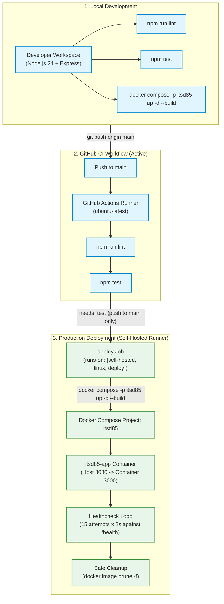

# itsd85-cicd-lab

Automated CI/CD from Local Dev to GitHub to Deployment Server — ITSD 85 Laboratory Exercise.

---

## 1. What This Project Does

`itsd85-cicd-lab` is a Node.js 24 + Express REST API designed as a testbed for implementing end-to-end continuous integration and deployment (CI/CD). It provides core endpoints for health monitoring and arithmetic computation, robust parameter validation, automated unit and integration testing via Node.js's native test runner, linting with ESLint flat configuration, container packaging via Docker and Docker Compose, and automated testing via GitHub Actions.

---

## 2. Technologies Used

- **Runtime Environment:** Node.js v24 (ES Modules, `"type": "module"`)
- **Web Framework:** Express 5
- **Testing Framework:** Node.js Built-in Test Runner (`node:test`) and Assertion Library (`node:assert/strict`)
- **Code Quality:** ESLint 10 (Flat Configuration: `eslint.config.js`) with `@eslint/js` and `globals`
- **Containerization:** Docker (`node:24-alpine`) and Docker Compose (`compose.yaml`)
- **Continuous Integration:** GitHub Actions (`.github/workflows/ci-cd.yml`)
- **Process & Architecture Modeling:** Mermaid Diagrams

---

## 3. API Endpoints

The API operates over HTTP and returns all responses in JSON format.

### 3.1. Welcome Endpoint
- **Method:** `GET`
- **Path:** `/`
- **Description:** Returns the project title, greeting message, and deployed application version.
- **Sample Request:**
  ```http
  GET / HTTP/1.1
  Host: localhost:3000
  ```
- **Sample Response (HTTP 200 OK):**
  ```json
  {
    "title": "itsd85-cicd-lab",
    "message": "Welcome to ITSD 85 CI/CD Lab API!",
    "version": "1.0.0-local"
  }
  ```

---

### 3.2. Health Check Endpoint
- **Method:** `GET`
- **Path:** `/health`
- **Description:** Returns `status: "ok"` and the deployed application version. Used by container health checks and deployment verification.
- **Sample Request:**
  ```http
  GET /health HTTP/1.1
  Host: localhost:3000
  ```
- **Sample Response (HTTP 200 OK):**
  ```json
  {
    "status": "ok",
    "version": "1.0.0-local"
  }
  ```

---

### 3.3. Addition Endpoint
- **Method:** `GET`
- **Path:** `/api/add`
- **Query Parameters:**
  - `a` (required, string representing a finite number): The first operand.
  - `b` (required, string representing a finite number): The second operand.

#### Successful Calculation
- **Sample Request:**
  ```http
  GET /api/add?a=2&b=3 HTTP/1.1
  Host: localhost:3000
  ```
- **Sample Response (HTTP 200 OK):**
  ```json
  {
    "result": 5
  }
  ```

#### Negative and Floating-Point Calculation
- **Sample Request:**
  ```http
  GET /api/add?a=-5&b=15 HTTP/1.1
  Host: localhost:3000
  ```
- **Sample Response (HTTP 200 OK):**
  ```json
  {
    "result": 10
  }
  ```

#### Invalid or Missing Parameters
- **Sample Request (Missing Parameter):**
  ```http
  GET /api/add?a=10 HTTP/1.1
  Host: localhost:3000
  ```
- **Sample Response (HTTP 400 Bad Request):**
  ```json
  {
    "error": "Invalid or missing numeric parameters \"a\" and \"b\"."
  }
  ```

- **Sample Request (Non-Numeric Parameter):**
  ```http
  GET /api/add?a=hello&b=5 HTTP/1.1
  Host: localhost:3000
  ```
- **Sample Response (HTTP 400 Bad Request):**
  ```json
  {
    "error": "Invalid or missing numeric parameters \"a\" and \"b\"."
  }
  ```

---

## 4. Prerequisites

- **Node.js:** v24.x or higher
- **npm:** v11.x or higher
- **Docker & Docker Compose:** Optional for local development; required for container builds and deployment.
- **Git:** Required for version control and pushing to GitHub.

---

## 5. Local Installation and Running Instructions

1. Clone or navigate to the repository directory:
   ```bash
   cd itsd85-cicd-lab
   ```

2. Install dependencies cleanly using `package-lock.json`:
   ```bash
   npm ci
   ```

3. Start the application in production mode:
   ```bash
   npm start
   ```
   The server will start on port `3000` (or `process.env.PORT` if set).

4. Alternatively, start in development watch mode (auto-reload on code change):
   ```bash
   npm run dev
   ```

---

## 6. Running Tests and Lint

### Run ESLint
To verify code formatting and static analysis rules:
```bash
npm run lint
```

### Run Automated Tests
To run unit and integration tests using Node.js's native test runner:
```bash
npm test
```

The test runner will execute:
- Unit tests validating [`add(a, b)`](file:///c:/Users/Admin/itsd85-cicd-lab/src/app.js#L7-L9) across positive numbers, negative numbers, decimals, zeros, and numeric strings.
- Integration tests validating `GET /`, `GET /health`, and `GET /api/add` response codes, headers, and validation errors.

---

## 7. Docker Deployment

### 7.1. Building and Running with Docker Compose (Recommended)

1. Build the Docker image and start the container in detached mode:
   ```bash
   docker compose up --build -d
   ```
   - The container is named `itsd85-app`.
   - The service maps host port `8080` to container port `3000`.
   - Health check runs automatically every 30 seconds against `/health`.

2. Test the running container:
   ```bash
   curl http://localhost:8080/health
   curl "http://localhost:8080/api/add?a=2&b=3"
   ```

3. View container logs:
   ```bash
   docker compose logs -f
   ```

4. Stop the container:
   ```bash
   docker compose down
   ```

### 7.2. Direct Docker CLI Execution

1. Build the image:
   ```bash
   docker build --build-arg APP_VERSION=1.0.0 -t itsd85-cicd-lab:latest .
   ```

2. Run the container:
   ```bash
   docker run -d --name itsd85-app -p 8080:3000 itsd85-cicd-lab:latest
   ```

---

## 8. GitHub Actions CI/CD Pipeline

The automated workflow is defined in [`.github/workflows/ci-cd.yml`](file:///c:/Users/Admin/itsd85-cicd-lab/.github/workflows/ci-cd.yml) and consists of two coordinated jobs:

### 8.1. CI Job (`test`)
- **Triggers:** Pushes to `main`, pull requests targeting `main`, and manual execution via `workflow_dispatch`.
- **Runner:** `ubuntu-latest`.
- **Steps:**
  1. Check out repository (`actions/checkout@v7`).
  2. Set up Node.js 24 with npm caching (`actions/setup-node@v7`).
  3. Clean dependency installation (`npm ci`).
  4. Code quality & lint check (`npm run lint`).
  5. Automated unit & integration tests (`npm test`).

### 8.2. CD Deployment Job (`deploy`)
- **Prerequisite:** `needs: test` (must pass CI).
- **Execution Condition:** Runs **only on pushes to `main`** (or manual dispatch on `main`); **never** triggers on pull requests.
- **Runner:** `[self-hosted, linux, deploy]` (targeted to the self-hosted runner on the Ubuntu deployment server).
- **Concurrency:** `group: production-deployment` (`cancel-in-progress: false`) to prevent overlapping deployments.
- **Steps:**
  1. Exact commit checkout (`actions/checkout@v7` with `ref: ${{ github.sha }}`).
  2. Container deployment using Docker Compose:
     `docker compose -p itsd85 up -d --build --remove-orphans` with `APP_VERSION=${{ github.sha }}`.
  3. Health check & version verification against `http://localhost:8080/health` (15 retries, 2s intervals) confirming `status: "ok"` and version matches `${{ github.sha }}`.
  4. Error handling: dumps container logs (`docker compose -p itsd85 logs --tail=100 web`) if health check fails.
  5. Safe cleanup: prunes only dangling images (`docker image prune -f`) without deleting active containers or volumes.

---

## 9. Deployment Architecture & Self-Hosted Runner



> **Note on Exporting the Diagram:** The editable Mermaid diagram source is saved in [`docs/pipeline.mmd`](file:///c:/Users/Admin/itsd85-cicd-lab/docs/pipeline.mmd). If a PNG is needed, you can render it using the Mermaid CLI (`npx @mermaid-js/mermaid-cli -i docs/pipeline.mmd -o docs/pipeline.png`) or by opening it with the Mermaid Preview extension in VS Code.

---

## 10. Results and Screenshots

- Execution records, duration metrics, and deployment status logs are tracked in [`docs/results.md`](file:///c:/Users/Admin/itsd85-cicd-lab/docs/results.md).
- Visual evidence and screen captures of terminal runs, GitHub CI builds, and container status are stored in [`docs/screenshots/`](file:///c:/Users/Admin/itsd85-cicd-lab/docs/screenshots/).

---

## 11. Known Limitations

- **Deployment Automation Pending:** Automated CD deployment to the production server is intentionally not yet configured pending provisioning of the Ubuntu VM and self-hosted runner.
- **Local Docker Engine:** The local development workstation does not have the Docker daemon installed; container build and execution verification is pending an environment with Docker available or will execute on the remote runner/server.
- **Single Node Architecture:** The current Compose configuration targets a single-container deployment without horizontal load balancing or reverse-proxy TLS termination.

